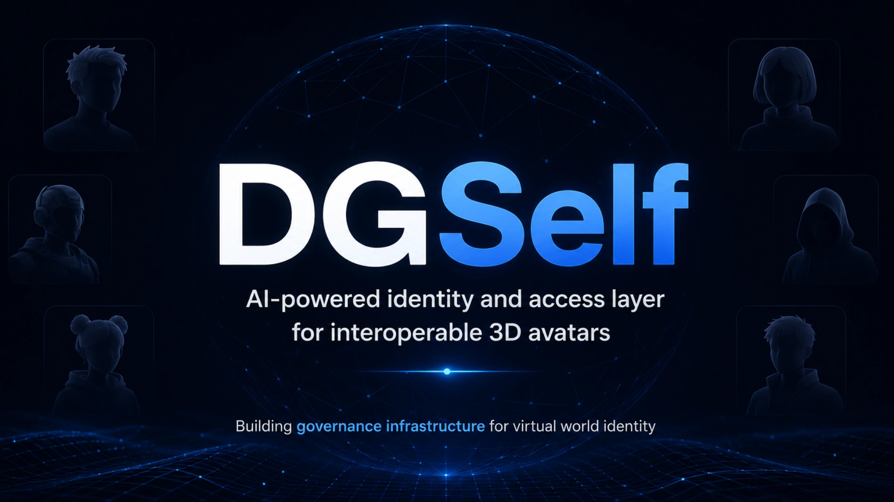

 
 

# DGSelf

### **AI-Powered Identity and Access Layer for Interoperable 3D Avatars**
*Building governance infrastructure for virtual world identity.*

 

 
 

---

## 🌐 Overview

Today, 3D avatars can move between virtual worlds technically, but creators lack reliable ways to enforce each experience’s **style, immersion, and role requirements**—limiting the real-world adoption of avatar interoperability.

**DGSelf** bridges this gap by combining a **personal multi-avatar hub for users** with **structured world access rules for developers**. Using AI-powered classification and a deterministic rules engine, DGSelf evaluates avatars at world entry and provides **human-readable, explainable feedback** when an avatar does not meet an experience’s requirements.

> **The Goal:** Make avatar interoperability practical and trustworthy—allowing users to carry their digital identities across virtual worlds while preserving every creator’s artistic vision.

---

## 🔑 Key Points

### 1. The Problem: Interoperability Exists Technically, But Fails Socially
- **Broken Immersion:** Without identity constraints, cartoon or meme avatars enter realistic, lore-driven medieval or sci-fi worlds (and vice versa).
- **Loss of Creative Control:** Developers avoid supporting cross-world avatars because unconstrained imports break visual tone, gameplay roles, and narrative integrity.

### 2. The Insight: The Missing Layer is Governance
- As UGC worlds and cross-platform avatars become standard, **interoperability needs rules to work**.
- Virtual worlds need an automated gatekeeper at entry that understands **what fits** each specific experience.

### 3. The Solution: Enforcing Avatar Compatibility at Entry

| 👤 For Players (**Avatar Hub**) | 🛠️ For Developers (**World Governance & SDK**) |
| :--- | :--- |
| **Store Multiple Avatars:** Build and manage all of your 3D identities in one unified personal hub. | **Define Avatar Rules Per Experience:** Configure allowed styles, roles, outfits, eras, and access constraints. |
| **Switch Identities Per World:** Seamlessly choose the right avatar for Fantasy, Sci-Fi, Stylized, or Social worlds. | **Protect Immersion & Lore:** Automatically prevent disruptive avatar mismatches at entry. |
| **Explainable AI Feedback:** Understand *why* an avatar was blocked and which identity in your hub fits the world. | **Drop-In SDK Gateway:** Enforce compatibility across game engines and frameworks without manual moderation. |

---

## ⚙️ DGSelf Core Architecture

DGSelf sits between **Users (Avatar Hub)** and **Experiences (Virtual Worlds)** as a four-part governance layer:

1. **⛩️ SDK Gateway** — Secure entry point for all virtual world and experience access requests.
2. **🎛️ Rules Engine** — Evaluates developer-defined constraints for style, roles, themes, outfits, and permissions.
3. **🧠 AI Classification** — Analyzes 3D avatar attributes, visual fidelity, proportions, and context.
4. **💬 Explainability Layer** — Generates clear, human-readable reasons for decisions (`Evaluate` → `Allow` / `Block` → `Explain`).

---

## 🎮 Experience DGSelf Live

Explore the full interactive showcase, test the **AI Gatekeeper Simulator**, and launch the **3D Unity WebGL Player Demo** directly in your browser:

 

 
 

**[https://dgself.github.io/](https://dgself.github.io/)**

